# LVLM Research Projects in Medical Imaging: How to Ramp Up

A starter guide to large vision-language models (LVLMs) for medical scans: the models, the data, and how to grow from a first experiment to your own research question · November 24, 2026 · Vani

Written for students in the [Duong Lab](https://sites.einsteinmed.edu/duong-lab), led by Dr. Tim Q. Duong in the Department of Radiology at Albert Einstein College of Medicine. Thanks to Dr. Duong and the lab for the research onboarding this guide builds on.

## Before you start

This guide builds on material the lab has already published. Do the [Duong Lab research onboarding VLM path](https://sites.google.com/view/research-onboarding-duong-lab/aillmvlm-path/vlm) first: it covers what a VLM is, how VLMs work, a pipeline example and an assessment. This guide picks up from there and applies it to medical scans.

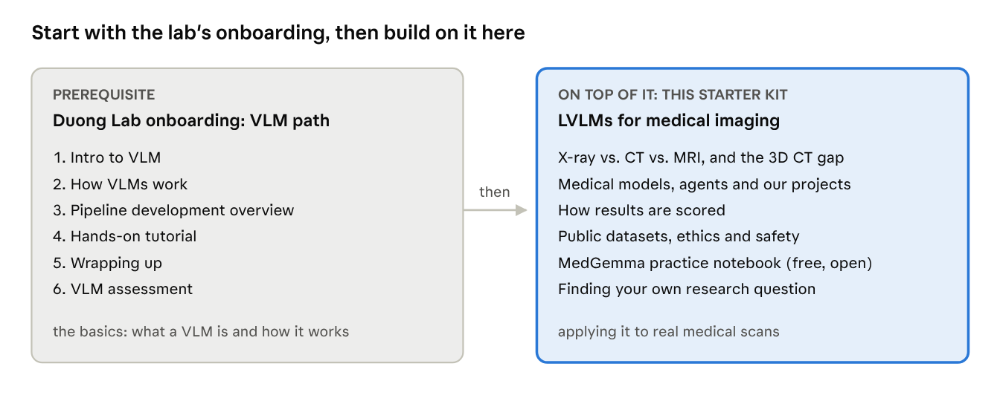

## Agenda

1. [Three kinds of medical AI models](#1-three-kinds-of-medical-ai-models) — classifiers, segmentation models and VLMs, then VLM vs. LVLM
2. [Our LVLM projects fall into three categories of medical imaging](#2-our-lvlm-projects-fall-into-three-categories-of-medical-imaging) — X-ray, CT, MRI, and the 3D CT gap
3. [How to approach a project: try first, train later](#3-how-to-approach-a-project-try-first-train-later) — where new students should start, my own path, your first project, and better prompts
4. [How results are scored](#4-how-results-are-scored) — caught it, missed it, false alarm, and AUC
5. [Available models](#5-available-models) — all-rounders and specialists for each scan type
6. [Agentic pipelines](#6-agentic-pipelines-ai-that-manages-a-team) — AI managers that use other models as tools
7. [Our projects: two agent pipelines](#7-our-projects-two-agent-pipelines) — my chest X-ray and lung CT pipelines
8. [Public datasets](#8-public-datasets-what-the-models-learn-from) — what's out there, how big, and how hard to get
9. [Ethics and safety](#9-ethics-and-safety) — privacy, bias, hallucination, and why AI assists doctors
10. [How to find a research question](#10-how-to-find-a-research-question) — a spot-the-gap checklist
11. [Advanced: training and fine-tuning options](#11-advanced-training-and-fine-tuning-options) — for later, once the basics work
12. [Key words to know](#12-key-words-to-know)
13. [Questions to discuss](#13-questions-to-discuss)
14. [Sources](#14-sources)

## 1. Three kinds of medical AI models

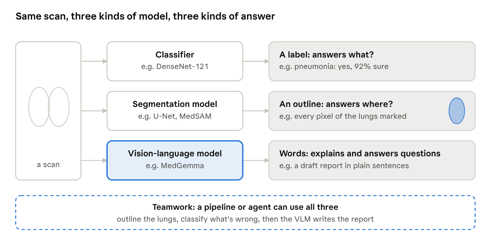

Classifiers and segmentation models are older, narrower AI tools, each trained for one job. They are often more accurate than a VLM at that one job, but they can't explain anything in words. VLMs are flexible and can talk, but they are less precise. That's why strong projects combine them: MedRAX uses a classifier and a segmentation model as tools, and lung CT projects pair VLMs with both.

This guide focuses on the third kind, vision-language models, and on how they team up with the other two.

### Zooming in: VLM vs. LVLM, by example

A vision-language model (VLM) is an AI that connects pictures and words. The big ones that can actually talk about an image, built on a large language model like the AI behind a chatbot, are called large vision-language models (LVLMs) or multimodal LLMs. You show one an image, ask a question in plain English, and it answers in plain English. MedGemma and MAIRA-2 are examples. This guide is mostly about those.

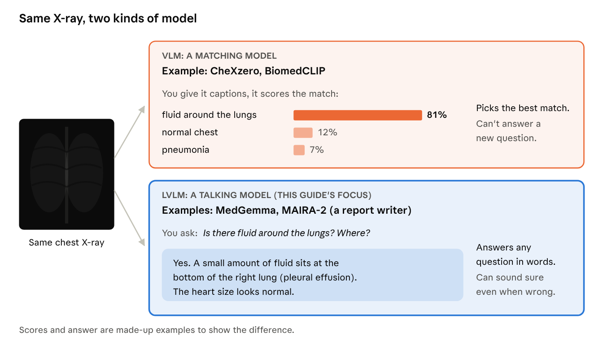

A matching VLM can only pick from captions you hand it. An LVLM answers your question in its own words, which is more useful and also riskier, because it can make things up. How these models work inside is covered in the onboarding VLM path.

**Why medicine cares:** hospitals take billions of scans a year and there are not enough radiologists (scan-reading doctors) to keep up. An AI that drafts a report, flags an urgent case, or gives a second opinion could save time and catch things people miss. It also has to be very reliable, because a wrong answer can hurt a patient.

## 2. Our LVLM projects fall into three categories of medical imaging

The type of scan decides how hard the AI's job is. Each step up adds a dimension the AI has to make sense of.

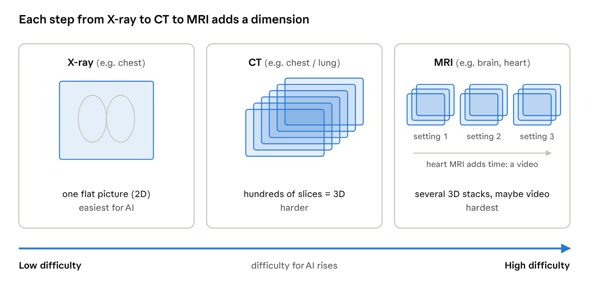

| Scan | Everyday comparison | What it shows | Why it is hard (or easy) for AI |
| --- | --- | --- | --- |
| X-ray (e.g. chest) | A single photo | Lungs, heart, ribs as one flat shadow picture | Easiest. One image, and there are huge public collections of X-rays with matching reports to learn from. |
| CT (e.g. chest / lung) | A loaf of bread cut into hundreds of thin slices | A 3D view of the body built from X-ray slices | Harder. The AI must keep track of hundreds of slices at once and understand what sits where in 3D. |
| MRI (e.g. brain, heart) | A stack of slices taken several ways, sometimes as a video | Soft tissue like the brain, muscles, and the beating heart | Hardest. Several "settings" per scan, sometimes motion over time, and far less shared training data. |

This is why the field is lopsided: chest X-ray models are the most mature, CT models are improving but still lag behind, and MRI models are still early.

**The 3D CT gap.** Compared with 2D chest X-ray, the 3D computed tomography (CT) scan remains largely underserved by modern VLMs (MRI is even further behind). Most popular models, including MedGemma, were built for flat pictures and only "flip through" a sample of a CT's slices instead of understanding the whole 3D volume. A handful of true 3D models now exist, but they still struggle with exact positions and sizes. Most of them focus on chest CT, because that is where the main public dataset (CT-RATE) is. Specific tasks, like measuring the airways or comparing two scans over time, are thinner still. That gap is why CT is a focus of our projects.

## 3. How to approach a project: try first, train later

The smart order is to test what already exists before training anything. Training is slow, costs computer time, and needs lots of labeled examples. Often an existing model, a better prompt, or a few added tools gets you most of the way. Think of it like cooking: taste the store-bought sauce first, then season it, and only make your own from scratch if nothing else works.

### Pick a starter topic: begin with chest X-ray

If you're new, start at the low-difficulty end: chest X-ray. Each X-ray is one flat picture, so it runs fast on a free GPU. There are many ready-made models to compare (MedGemma, CheXagent, MAIRA-2), working agent code you can study (MedRAX), and large public datasets. You spend your energy learning the ideas, not fighting the data. Once you're comfortable, move up to 3D CT or MRI.

Two honest cautions:

- **Fully open data first.** MIMIC-CXR needs a registration and an ethics course that can take weeks. NIH ChestX-ray14 and VQA-RAD can be downloaded right away, so start there.
- **Easy to learn, hard to stand out.** Chest X-ray is the most crowded area, so a brand-new result is harder to find there. Use it to build skills, then look for a less-explored question.

### My path: X-ray first, now CT

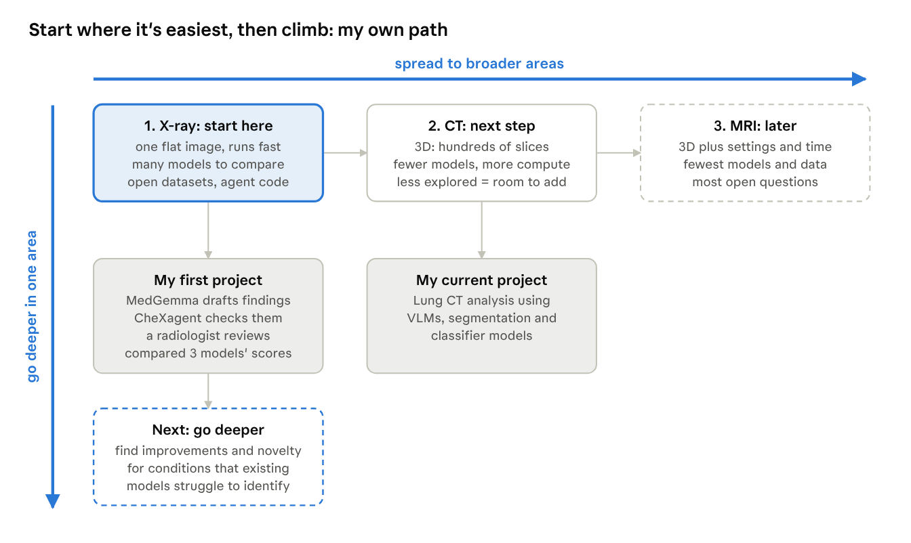

The X-ray project taught me the basics, which made the jump to 3D CT much easier.

**Future work, early start: cardiac MRI.** I've begun on MRI with a local pipeline that outlines the heart's chambers on cardiac MRI "movies" (cine MRI) and measures how well the heart pumps. It's early research, and nothing here is clinically validated. Note that [CineMA](https://github.com/mathpluscode/CineMA), the model it uses, is an image model that outlines and measures, not a VLM.

- **What I built:** a setup around CineMA, a published AI model for cardiac MRI, running on a local computer in its own isolated environment, so no patient data leaves the machine. The pipeline reads the scanner files, finds the short-axis series (the stack of cross-section slices), outlines the left ventricle, right ventricle and heart muscle on every frame, calculates volumes and ejection fraction (EF, the share of blood pumped out per beat), and makes side-by-side videos. 24 automated tests check the geometry and volume math on shapes with known answers; all pass.
- **What I ran:** a public sample to confirm the setup works, then an inventory of 11 hospital cases (about 18,700 image files). A likely short-axis series turned up in each case, though three still need confirming. One case went end to end with three versions of the model.
- **What it showed:** for the left ventricle, the three versions agreed closely (EF 63–65%, about 112–116 ml when full), and spot-checked outlines looked reasonable. For the right ventricle, they disagreed on the top slice near the valves, which swung EF between 52% and 65%, so it isn't usable yet.
- **The honest limit:** no accuracy was measured. This case has no expert outlines, and models agreeing with each other is not proof that they're right.

**Step 0: build a small test set first.** Collect 50 to 200 of *your* images with the correct answers, and decide how you'll score them (accuracy, or how many findings the report gets right). Every step below gets judged on this same test, so you can tell whether a change actually helped.

Then climb the ladder below, and only move up a rung if the one below doesn't score well enough on your test:

1. **Try it as-is ("zero-shot").** Run a few ready-made models, such as MedGemma, CheXagent, and a general model like GPT or Claude, on your test set with no changes. This takes hours, not weeks.
2. **Improve the instructions (prompting).** Give clearer directions, show two or three worked examples in the prompt, or ask the model to explain step by step before answering.
3. **Add tools.** Build a multi-model agent pipeline: an AI manager that calls other specialist models as tools, like MedRAX does. Still no training needed.
4. **Train a small add-on.** Keep the model frozen and train only a tiny piece on your data. This is cheap and can run on one graphics card (GPU).
5. **Fine-tune more of the model.** Only when the steps above fall short and you have enough good data.

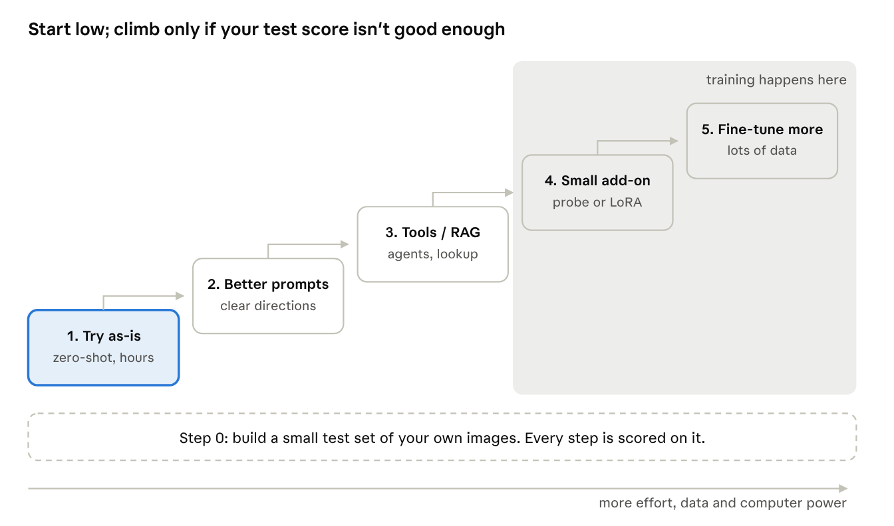

Steps 4 and 5 involve training, an advanced topic. They are covered in the "Advanced" section near the end.

### Your first project

This is step 1 of the ladder, done for real. You test MedGemma on one simple question, "Is there fluid around the lungs in this X-ray?", using 20 chest X-rays you pick yourself. Everything is in our project repo, in the [`medgemma-practice`](../medgemma-practice/) folder: a ready-to-run MedGemma practice notebook for Colab ([`medgemma_practice.ipynb`](../medgemma-practice/medgemma_practice.ipynb)), plus one script per step if you'd rather run it on your own computer.

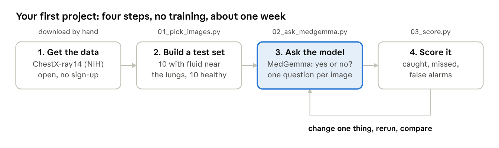

The score shows how often it **caught** a real case, **missed** one, or raised a **false alarm**. Then change one thing (the question's wording, the finding, or the model), rerun, and compare. Twenty images is a demo, not a result: one image changes the score by 5 percentage points.

### Better prompts: step 2 of the ladder in action

The wording of the question alone can change the score. The notebook's optional Step 5 asks MedGemma the same question four ways and compares the results.

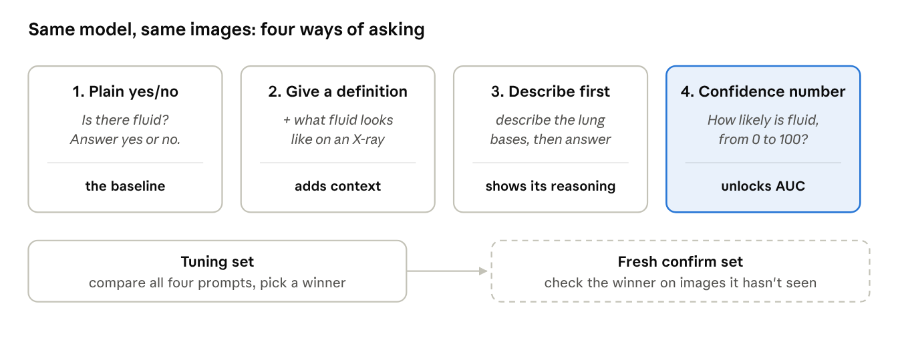

Two rules keep the comparison honest. Use enough images (25 + 25 per set, not 20 in total), so a "win" isn't just luck. And never pick the winner and grade it on the same images: choose on a tuning set, then confirm on fresh images it has never seen.

**Two real examples from our projects.** Small wording changes flipped real results in both of my pipelines.

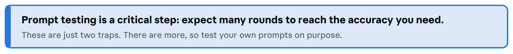

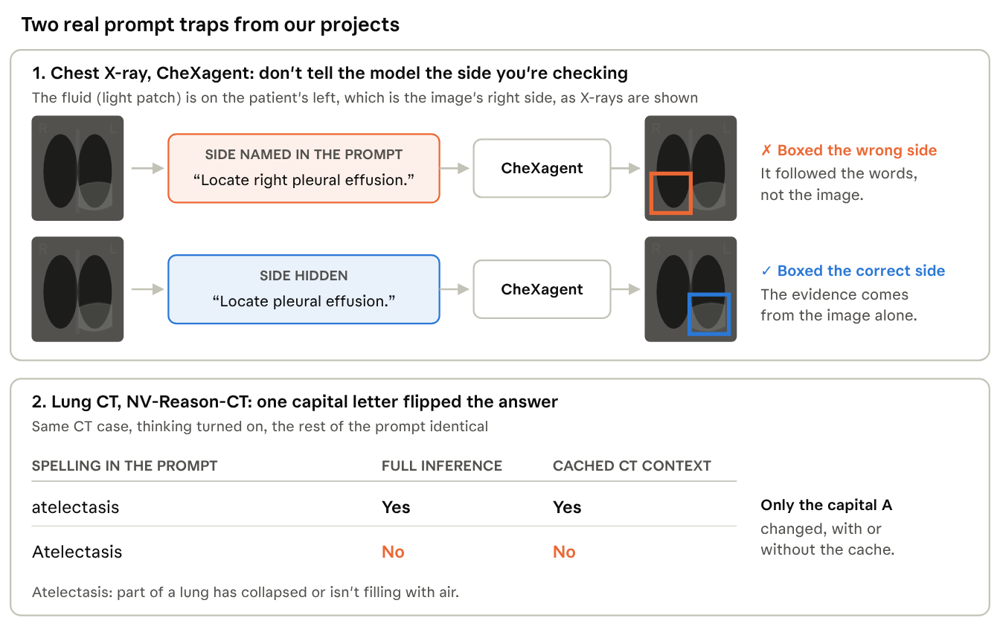

Two lessons. First, the model becomes biased when the prompt hands it the answer. Give it a detail like the side (right vs. left) and it tends to go along with what we gave it instead of checking the image: naming "right" made CheXagent box the right side even though the fluid was on the left. This is sometimes called anchoring. So when you use a model to check a claim, don't put the claim in the prompt. Ask neutrally and compare the answer to the claim afterward. Second, fix your exact prompt text and test small variants on purpose. Models read text as tokens, so "atelectasis" and "Atelectasis" can look different to them. Each example is a single case, so treat it as a warning sign to test for, not a measured error rate.

## 4. How results are scored

You can't say a model is good without a score, and in medicine the *kind* of mistake matters. Every yes/no answer lands in one of four boxes.

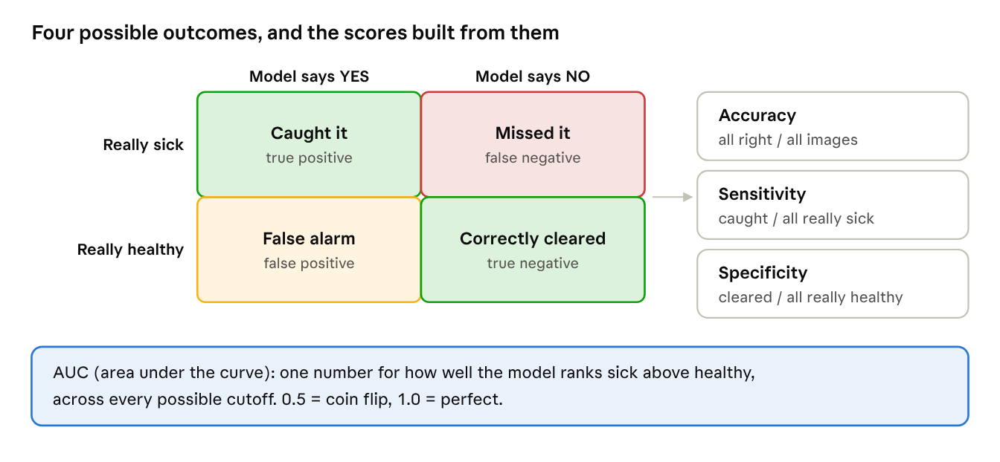

- **Accuracy can fool you.** If only 5 in 100 X-rays show disease, a model that always says "healthy" scores 95% while catching nothing. Always look at the next two numbers too.
- **Sensitivity vs. specificity is a trade-off.** Make the model say "yes" more easily and it misses fewer real cases (higher sensitivity) but raises more false alarms (lower specificity). For a screening tool, missing a sick patient is usually the worse mistake.
- **AUC compares models fairly.** It needs a confidence score for each image, not just yes or no, and it doesn't depend on picking one cutoff. My X-ray project used AUC to compare MedGemma, CheXagent and MAIRA-2 across several datasets. The MedGemma practice notebook gets plain yes/no answers, so it reports accuracy, sensitivity and specificity instead.

## 5. Available models

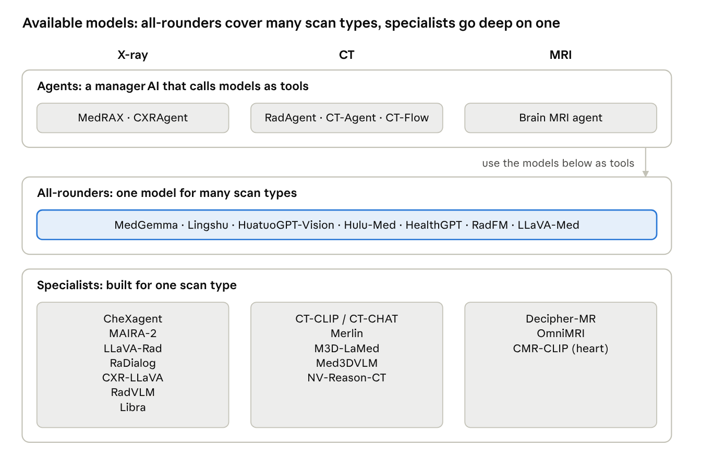

Models come in three layers. All-rounders handle many scan types, specialists are built for one, and agents sit on top and use both as tools. The lists below give more detail on each group. Agents have their own section further down.

### The all-rounders: models that read many kinds of scans

These are like a family doctor: decent at many things, not the top expert at any one. The current favorite starting point is Google's MedGemma.

| Model | Made by | What to know |
| --- | --- | --- |
| [MedGemma 1.5](https://arxiv.org/abs/2604.05081) | Google | The model most new research compares against. Version 1.5 added CT and MRI volumes, pathology slides, and drawing boxes around findings. It reads a CT by sampling 2D slices, like flipping through a stack of photos. |
| [LLaVA-Med](https://github.com/microsoft/LLaVA-Med) | Microsoft | The 2023 original "chat with a medical image" model. Now mostly the older model new ones are measured against. |
| Lingshu | Open research group | A strong newer all-rounder, often ranked close to MedGemma. |
| HuatuoGPT-Vision | Open research group | Popular because both the model and its training data are public. |
| [Hulu-Med](https://github.com/ZJUI-AI4H/Hulu-Med) | Zhejiang University | Built to be fully transparent: code, models, and data all released. |
| HealthGPT | Open research group | Can both understand medical images and generate them. |
| RadFM | Open research group | An early model that handles both 2D and 3D radiology scans. |
| Med-PaLM M | Google | Well known but not released to the public. |

General-purpose AIs with no special medical training, like GPT, Gemini, and Claude, are also tested a lot. They often do surprisingly well.

### Chest X-ray specialists

Chest X-ray is the busiest area because it is the most common scan in the world and a large public dataset (MIMIC-CXR) pairs hundreds of thousands of X-rays with real doctors' reports. CheXagent is the best-known specialist.

| Model | Made by | Its special skill |
| --- | --- | --- |
| CheXagent | Stanford | All-round chest X-ray expert. Its "eyes" are so good that other projects reuse them on their own. |
| MAIRA-2 | Microsoft | Writes the report *and* points to where each finding is on the image (called "grounding"). |
| LLaVA-Rad | Microsoft | A small, focused report writer. |
| RaDialog | TU Munich | Holds a back-and-forth conversation, so you can ask it to fix or explain its report. |
| CXR-LLaVA | Open research | Report writing plus yes/no diagnosis. |
| [RadVLM](https://arxiv.org/abs/2502.03333) | Univ. of Zurich | Many chest X-ray tasks in one chat-style model. |
| Libra | Open research | Compares an older and a newer X-ray of the same patient to see what changed. |

**How do they stack up?** In one 2025 comparison, CheXagent got 78.1% right on a medical question-answering task. MedGemma got 77.2%, and general-purpose GPT-4o got 85.1% ([CXRAgent paper](https://arxiv.org/abs/2510.21324)). A specialist is not automatically the winner.

### CT specialists: reading in 3D

A CT scan is hundreds of slices stacked into a 3D block. True 3D models read the whole block at once, the way a doctor scrolls through it, instead of looking at a few slices.

| Model | Made by | Its special skill |
| --- | --- | --- |
| [CT-CLIP and CT-CHAT](https://arxiv.org/abs/2403.17834) | Univ. of Zurich | Chest CT. CT-CLIP matches scans to text; CT-CHAT answers questions and was trained on over 2.7 million question-answer pairs. |
| [Merlin](https://www.ncbi.nlm.nih.gov/pmc/articles/PMC11230513/) | Stanford | Belly (abdominal) CT. Learned from 15,331 CT scans plus their reports and diagnosis codes. |
| M3D-LaMed | Open research | A general 3D CT model; a common baseline. |
| Med3DVLM | Open research | Newer 3D CT question answering. |
| [NV-Reason-CT](https://arxiv.org/abs/2609.27511) | NVIDIA | Newer CT model built to reason step by step. |

Researchers have found that many 3D models still struggle with exact positions, like which of two spots is higher or closer to the heart.

### MRI specialists: the newest frontier

MRI is the least developed area. Each MRI scan can include several different "settings" (called sequences), and heart MRIs are basically videos of the heart beating. There is also much less public MRI data to train on.

| Model | Made by | Its special skill |
| --- | --- | --- |
| [Decipher-MR](https://arxiv.org/abs/2509.21249) | Open research | A general 3D MRI model trained on about 200,000 MRI series from over 22,000 exams across the whole body. |
| [OmniMRI](https://arxiv.org/abs/2508.17524) | Mass General (Martinos Center) | One model for many MRI jobs: cleaning up the image, outlining organs, spotting problems, and writing a report. |
| [CMR-CLIP](https://www.jmir.org/2026/1/e106121) | Cleveland Clinic | Heart (cardiac) MRI. It treats each scan like a video so it can learn how the heart moves; trained on more than 11,000 patient exams. |

MedGemma 1.5 and RadFM can also take MRI, but they are generalists, not MRI experts. Because so few MRI models exist, this is a wide-open area for new research.

## 6. Agentic pipelines: AI that manages a team

An agent is not one model. It is a system where a language model acts as the manager: it reads the question, decides which specialist tools to use, runs them, checks the results, and writes the final answer. Many of the models above (CheXagent, MAIRA-2, LLaVA-Med) show up *inside* agents as tools.

**Analogy:** a single VLM is one doctor glancing at a scan. An agent is the attending physician running a care team: order the lab test, ask the radiologist, call a specialist, compare their answers, then decide.

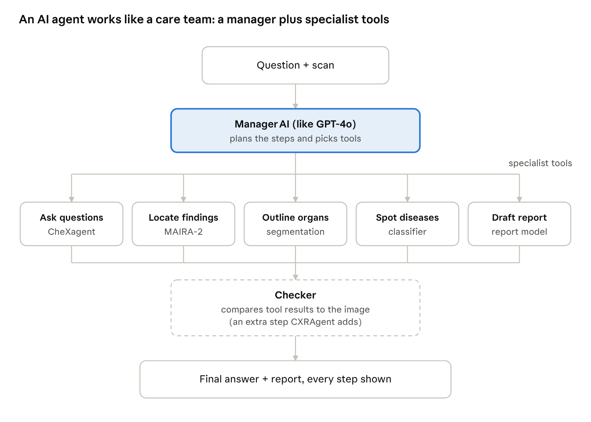

The manager hands the scan to each specialist tool, gathers what they found, and writes one answer. Because every step is recorded, a doctor can see exactly how it got there.

|  | Single VLM | Agent |
| --- | --- | --- |
| Structure | One model: image in, text out | A manager AI plus many tools |
| Strength | Simple and fast | Uses the best tool for each step and can double-check |
| Can you see its reasoning? | Usually not | Yes, each step and tool call is logged |
| How to improve it | Retrain the whole model | Swap in or add a better tool |

### Agents by scan type

| Scan | Agent | What makes it notable |
| --- | --- | --- |
| Chest X-ray | [MedRAX](https://github.com/bowang-lab/medrax) (Bo Wang lab, 2025) | The first widely used chest X-ray agent. GPT-4o manages tools for questions (CheXagent, LLaVA-Med), locating findings (MAIRA-2), outlining, disease spotting (18 diseases), report writing, and even making synthetic X-rays. |
| Chest X-ray | [CXRAgent](https://github.com/laojiahuo2003/CXRAgent/) | Adds a "director" that works in three stages (call tools, plan the diagnosis, decide as a team) and a checker that confirms each tool result against visual evidence. |
| CT | [RadAgent](https://arxiv.org/abs/2604.15231) | Writes chest CT reports step by step, with a full trail of every decision. |
| CT | CT-Agent | Sends the scan to ten specialized reasoning tools at once. |
| CT | [CT-Flow](https://arxiv.org/abs/2603.00123) | Connects tools through the Model Context Protocol (MCP), a standard "plug" for AI tools. |
| MRI | [Brain MRI agent](https://arxiv.org/abs/2604.16729) (2026) | Runs a full brain MRI workflow (cleanup, outlining, measuring volume, conclusions) with no extra training. |
| Many | [MMedAgent](https://arxiv.org/abs/2407.02483) (2024) | An early agent that learned on its own which of six medical tools to pick across five scan types. |

### How agents are tested

- **ChestAgentBench:** 2,500 tough chest X-ray questions built from 675 expert-checked cases.
- **CT-FlowBench:** tests whether a CT agent uses its tools correctly, step by step.
- **RadABench:** tests how well different AIs work as the manager. Its warning: many still fumble when a task needs lots of tools in the right order.

## 7. Our projects: two agent pipelines

Both of my projects are agent pipelines: several models, each doing the job it's best at, with checks between them.

### Chest X-ray: draft, check, review

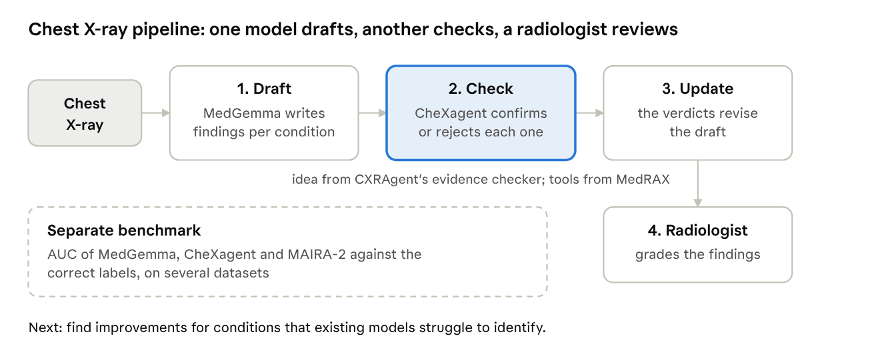

One VLM writes the first draft and a second VLM double-checks it, the way a resident's report gets checked by a senior doctor. A radiologist grades the final findings, and a separate benchmark compares the models' AUC on several datasets.

### Lung CT: measure, classify, look, cross-check

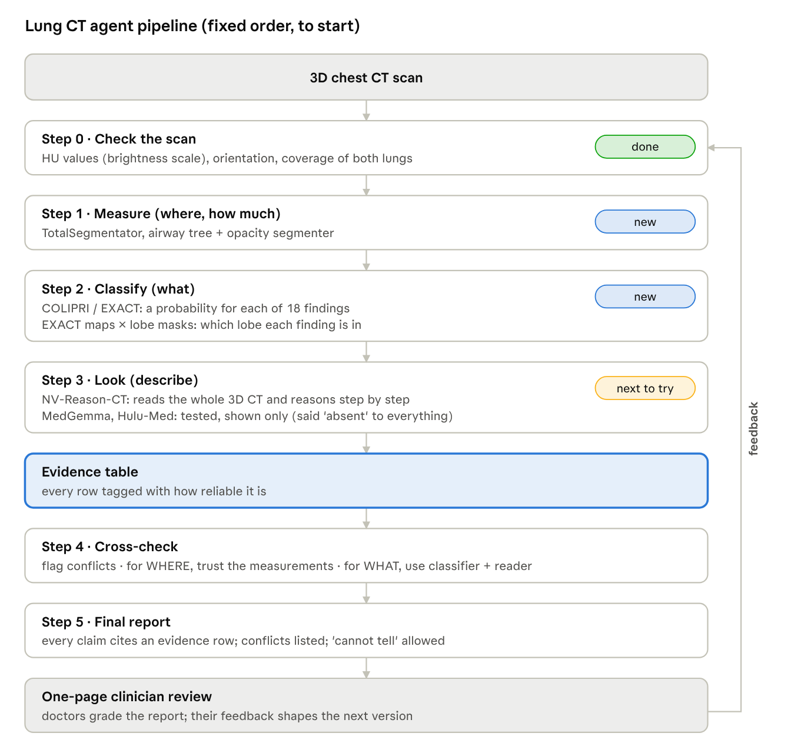

Each step answers a different question with the tool best suited to it: segmentation models measure *where* and *how much*, classifiers say *what*, and a VLM *describes*. Everything lands in one evidence table, and the final report may only claim what that table supports. It's allowed to say "cannot tell".

One finding shaped this design: general medical VLMs (MedGemma, Hulu-Med) answered "absent" to every finding on our CT scans, so they are shown in the report but not trusted. Next we're trying [NV-Reason-CT](https://developer.nvidia.com/blog/introducing-nv-reason-ct-open-3d-ct-vlm-for-radiologist-chain-of-thought-reasoning/), a VLM built to read the whole 3D scan.

## 8. Public datasets: what the models learn from

An AI is only as good as the examples it learns from, and medical images are hard to share because they belong to real patients. The datasets below have been "de-identified" (names and personal details removed) and released for research. The sizes explain a lot: chest X-ray has hundreds of thousands of examples, CT has tens of thousands, and MRI has far fewer. That is the same order as how mature each group of models is.

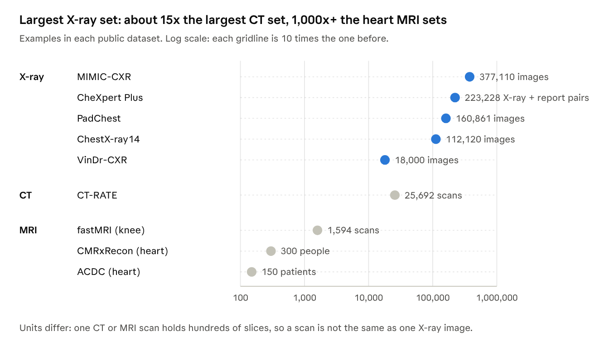

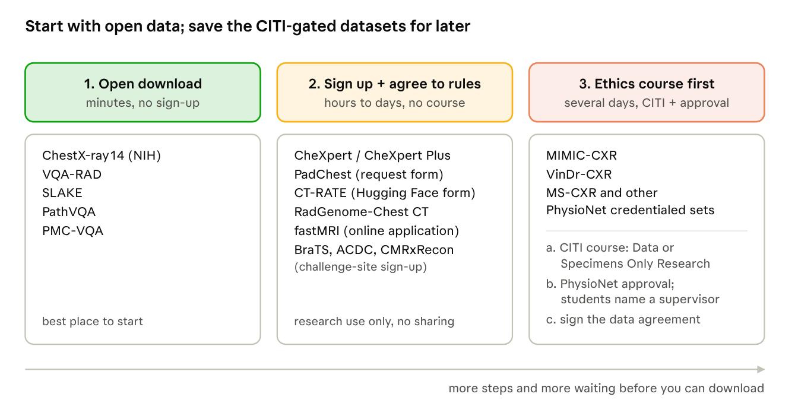

How easy a dataset is to get matters as much as its size. Open sets download right away. Most others need a sign-up and a promise to use the data only for research. The PhysioNet "credentialed" sets, including MIMIC-CXR, need a CITI ethics course and an approval that takes several business days, and students must name a supervisor. Rules checked on: [MIMIC-CXR](https://physionet.org/content/mimic-cxr/2.1.0), [VinDr-CXR](https://www.physionet.org/content/vindr-cxr/), [PhysioNet access tiers](https://casrai.org/guides/physionet-credentialed-access-restricted-data), [PadChest agreement](https://bimcv.cipf.es/?p=4923), [fastMRI](https://fastmri.med.nyu.edu/), [CT-RATE](https://huggingface.co/datasets/ibrahimhamamci/CT-RATE).

### Chest X-ray

| Dataset | Where it's from | Size | Why it matters |
| --- | --- | --- | --- |
| [MIMIC-CXR](https://www.ncbi.nlm.nih.gov/pmc/articles/PMC6908718/) | Beth Israel Deaconess Medical Center, Boston | 377,110 images, 227,835 reports, 65,379 patients | The most-used dataset for teaching AI to write X-ray reports. |
| [CheXpert Plus](https://arxiv.org/abs/2405.19538) | Stanford Hospital | 223,228 image-report pairs, 64,725 patients | Added the reports and patient details to the original CheXpert images. |
| ChestX-ray14 (NIH) | U.S. National Institutes of Health | 112,120 images, 30,805 patients | An early, very popular set labeled with 14 diseases (no full reports). |
| PadChest | Hospital San Juan, Spain | About 160,000 images, 67,000 patients | Big, with reports in Spanish. |
| VinDr-CXR | Two hospitals in Hanoi, Vietnam | 18,000 images | Doctors drew boxes around findings, which is useful for "point to it" training. |

### CT

| Dataset | Where it's from | Size | Why it matters |
| --- | --- | --- | --- |
| [CT-RATE](https://huggingface.co/datasets/ibrahimhamamci/CT-RATE) | Turkey (University of Zurich team) | 25,692 chest CT scans from 21,304 patients, expanded to 50,188 volumes | The first public 3D CT set with matching reports. CT-CLIP and CT-CHAT were trained on it. |
| [RadGenome-Chest CT](https://arxiv.org/abs/2404.16754) | Built on top of CT-RATE | Over 1.3 million grounded question-answer pairs | Links each sentence of a report to a region of the scan, so models can learn *where*, not just *what*. |

### MRI

| Dataset | What it covers | Size | Why it matters |
| --- | --- | --- | --- |
| BraTS | Brain tumors | Hundreds to thousands of cases, depending on the year | A yearly challenge since 2012; each case has four MRI settings plus tumor outlines. |
| [fastMRI](https://arxiv.org/abs/1811.08839) | Knee and brain | Thousands of scans | Raw scanner data from NYU and Meta AI, used to make MRI faster and clearer. |
| ACDC | Heart (cine) | 150 patients | The largest fully outlined public heart MRI set; five groups (healthy plus four diseases). |
| [CMRxRecon](https://arxiv.org/abs/2309.10836) | Heart (cine and mapping) | 300 people | Raw heart MRI data, including the "video" cine scans. |

### Question-and-answer test sets

These are mostly used as *tests* (benchmarks), not for main training.

| Dataset | Images | Questions | What's in it |
| --- | --- | --- | --- |
| VQA-RAD | 315 | 3,515 | Head, chest, and belly scans with questions written by doctors. |
| SLAKE | 642 | 14,028 | X-ray, CT, and MRI; in English and Chinese. |
| PathVQA | 4,998 | 32,799 | Tissue slides under a microscope (pathology). |
| [PMC-VQA](https://arxiv.org/abs/2305.10415) | 149,000 | 227,000 | Built from figures in published medical papers; about 80% are radiology images. |

**Good to know:** "public" does not always mean one-click download. MIMIC-CXR, CT-RATE, and others ask you to register, agree to rules about patient privacy, and sometimes complete a short research-ethics course first.

## 9. Ethics and safety

Medical AI works with real patients' scans, so four rules apply to every project, including a first one.

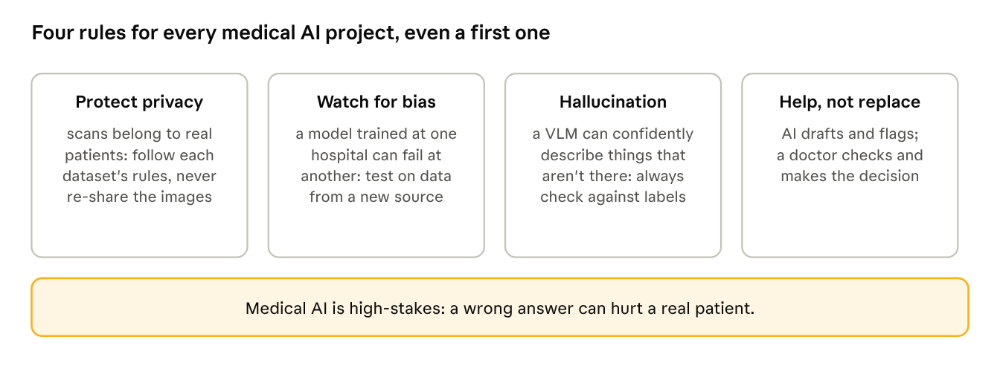

One more habit: if a result looks too good to be true, check for a data leak before celebrating. The most common one is images from the same patient in both the training set and the test set.

## 10. How to find a research question

A good student research question is small, specific, and testable with data you can actually get. Run through three questions with your first project's results in hand.

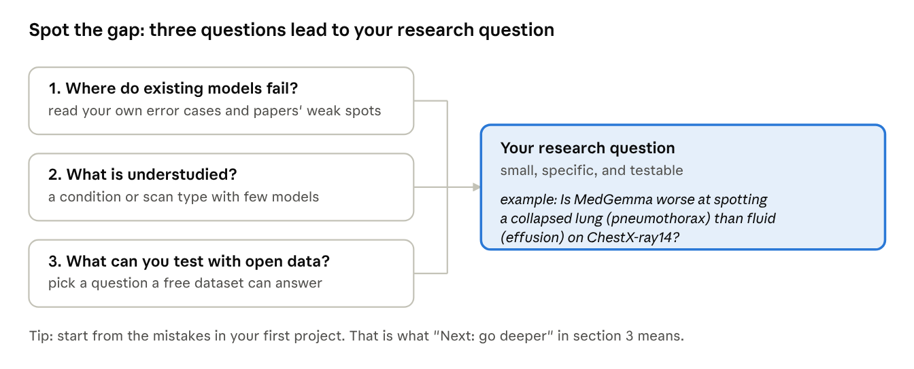

Before you start, check whether someone has already answered your question (search Google Scholar or arXiv), and talk it over with a teacher or mentor. A question that's already answered isn't wasted: repeating someone's result on different data is real research too.

## 11. Advanced: training and fine-tuning options

This is steps 4 and 5 of the ladder. Come back to it after you've tried an existing model, better prompts, and tools on your own test set. The options run from lightest to heaviest. Quick names for an LVLM's three parts: the "eyes" (vision encoder) turn the image into numbers, the "talker" (language model) writes the answer, and the "translator" (connector) links the two.

| Option | What gets trained | Data you need | Computer power | When it fits |
| --- | --- | --- | --- | --- |
| Linear probe | Just a tiny classifier on top of the frozen "eyes" | Hundreds of labeled images | A laptop or one small GPU | Yes/no or category questions (is there a nodule?) |
| LoRA / QLoRA | Small add-on layers; the main model stays frozen | Hundreds to a few thousand examples | One GPU | Teaching the model your task, wording, or report style. The most common choice today. |
| Train the connector | The "translator" between eyes and talker | Many image-text pairs | One to a few GPUs | Plugging in a new kind of image the eyes weren't built for |
| Full fine-tuning | Every part of the model | Tens of thousands of examples or more | Several large GPUs | A big new domain, when you have lots of data |
| Reinforcement learning (RL) | The model is rewarded for correct answers and its own reasoning | Can work with a few hundred questions | One to several GPUs | Getting the model to show its reasoning and handle new cases better |
| Training from scratch | Everything, starting empty | Millions of examples | Big clusters of GPUs | Big labs building new base models; almost never a student project |

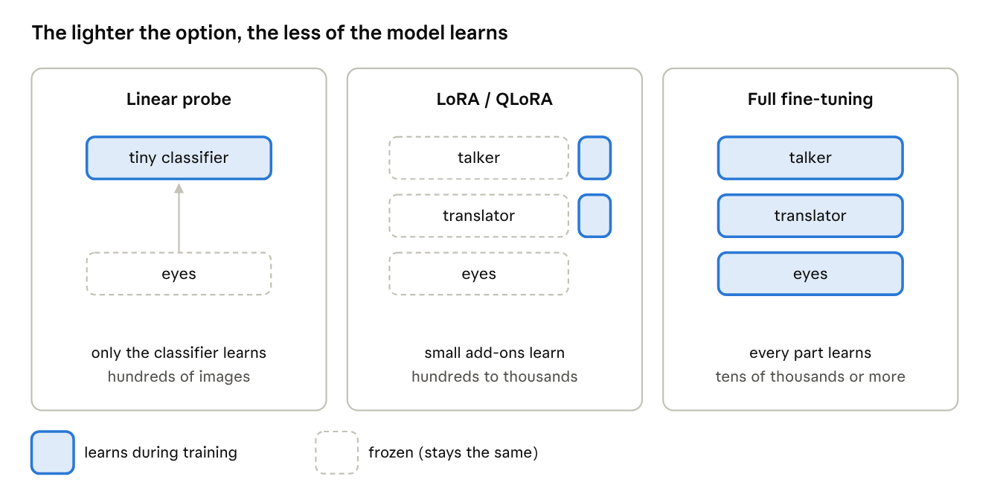

Blue parts change during training; dashed parts stay frozen. LoRA's small add-ons are the "sticky notes" described below.

**What these words mean:**

- **LoRA** (low-rank adaptation) adds small, trainable "sticky notes" to a frozen model instead of rewriting the whole book. **QLoRA** also shrinks the main model to 4-bit numbers so it fits in less memory. With QLoRA, the pretrained model is quantized to 4-bit and frozen, and only the attached adapter layers are trained ([Google guide](https://ai.google.dev/gemma/docs/core/huggingface_text_finetune_qlora)). This is how most groups adapt MedGemma 4B.
- **Reinforcement learning (RL)** works like practice with a scorekeeper: the model tries an answer, gets points if it's right, and gradually learns better reasoning. A popular method called GRPO scores answers with simple rules instead of a separate judging model ([MedVLM-R1](https://arxiv.org/abs/2502.19634)). MedVLM-R1 used only 600 visual question-answer samples on a 2-billion-parameter model and raised accuracy from 55.11% to 78.22% across MRI, CT, and X-ray questions. Researchers are still debating how much RL truly adds beyond regular fine-tuning ([2026 study](https://arxiv.org/abs/2603.01301)).

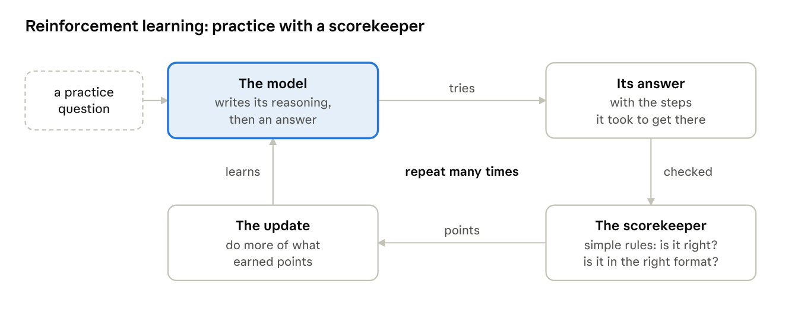

### Free tools for doing it

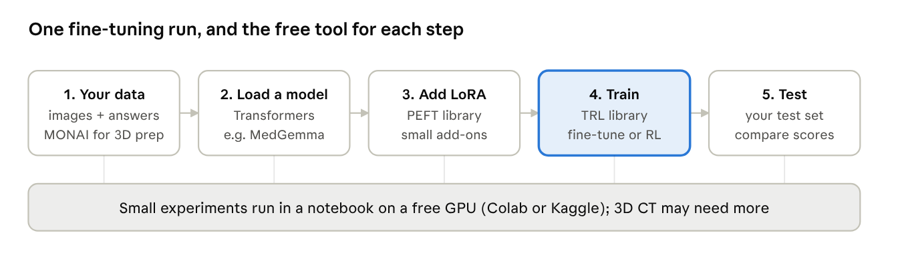

Worked example to follow: [fine-tuning MedGemma 4B on a brain MRI dataset](https://www.datacamp.com/tutorial/fine-tuning-medgemma) with LoRA. Google's official MedGemma notebooks use the same steps.

**Rule of thumb:** fine-tuning on a small dataset can make a model great on *your* hospital's images and worse on everyone else's. Always keep some test images the model never trained on, ideally from a different source.

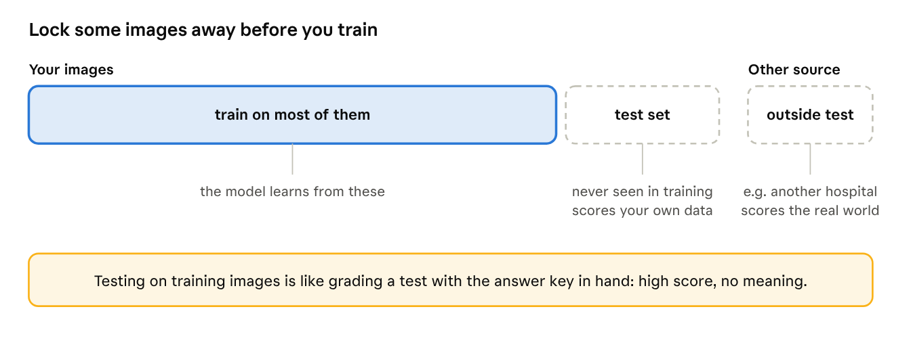

## 12. Key words to know

| Term | Plain meaning |
| --- | --- |
| VLM / LVLM | VLM: any AI that connects pictures and words. LVLM: the large kind, built on a language model, that can talk about an image (also called a multimodal LLM). |
| Vision encoder | The "eyes": turns a picture into numbers the AI can work with. |
| Language model (LLM) | The "talker": reads and writes text. |
| Fine-tuning | Extra training on a specific topic, like medical images. |
| Grounding | Pointing to *where* in the image a finding is, not just naming it. |
| VQA | Visual question answering: asking a question about an image. |
| Benchmark | A standard test used to compare models fairly. |
| Agent | An AI "manager" that plans steps and uses tools to finish a task. |
| Tool | Any program an agent can call, like a measuring tool or another AI model. |
| 3D volume | A scan made of many stacked slices, like a CT or MRI. |

## 13. Questions to discuss

1. If an AI and a doctor disagree about a scan, who should decide, and why?
2. Why might a general AI sometimes beat a medical-specialist AI?
3. An agent can show every step it took. Why might doctors trust that more than a single answer?
4. Why is MRI harder for AI than a chest X-ray? What would help close the gap?
5. What could go wrong if an AI is trained mostly on scans from one country or one hospital?

## 14. Sources

- [MedGemma 1.5 technical report](https://arxiv.org/abs/2604.05081)
- [Fragility in medically fine-tuned VLMs (2026)](https://arxiv.org/abs/2604.09841)
- [MedVLMBench: generalist vs. specialist medical VLMs](https://arxiv.org/abs/2506.17337)
- [Hulu-Med](https://arxiv.org/abs/2510.08668)
- [RadVLM](https://arxiv.org/abs/2502.03333)
- [CT-CLIP and CT-CHAT](https://arxiv.org/abs/2403.17834)
- [Merlin](https://www.ncbi.nlm.nih.gov/pmc/articles/PMC11230513/)
- [NV-Reason-CT](https://arxiv.org/abs/2609.27511)
- [Decipher-MR](https://arxiv.org/abs/2509.21249)
- [OmniMRI](https://arxiv.org/abs/2508.17524)
- [CMR-CLIP (JMIR news)](https://www.jmir.org/2026/1/e106121)
- [MedRAX on GitHub](https://github.com/bowang-lab/medrax)
- [CXRAgent on GitHub](https://github.com/laojiahuo2003/CXRAgent/) and [paper](https://arxiv.org/abs/2510.21324)
- [RadAgent](https://arxiv.org/abs/2604.15231)
- [CT-Flow](https://arxiv.org/abs/2603.00123)
- [Brain MRI agent pipeline](https://arxiv.org/abs/2604.16729)
- [MMedAgent](https://arxiv.org/abs/2407.02483)
- [RadABench: can LLMs be agent cores in radiology?](https://arxiv.org/abs/2412.09529)

- [MIMIC-CXR paper](https://www.ncbi.nlm.nih.gov/pmc/articles/PMC6908718/)
- [CheXpert Plus (with comparison of chest X-ray datasets)](https://arxiv.org/abs/2405.19538)
- [CT-RATE on Hugging Face](https://huggingface.co/datasets/ibrahimhamamci/CT-RATE)
- [RadGenome-Chest CT](https://arxiv.org/abs/2404.16754)
- [fastMRI](https://arxiv.org/abs/1811.08839)
- [CMRxRecon](https://arxiv.org/abs/2309.10836)
- [PMC-VQA](https://arxiv.org/abs/2305.10415)
- [PathVQA](https://arxiv.org/abs/2003.10286)

- [Fine-tune Gemma with Hugging Face and QLoRA (Google)](https://ai.google.dev/gemma/docs/core/huggingface_text_finetune_qlora)
- [Fine-tuning MedGemma on a brain MRI dataset (DataCamp)](https://www.datacamp.com/tutorial/fine-tuning-medgemma)
- [MedVLM-R1: reinforcement learning for medical VLMs](https://arxiv.org/abs/2502.19634)
- [Med-R1](https://arxiv.org/abs/2503.13939)
- [Does RL improve medical visual reasoning? (2026)](https://arxiv.org/abs/2603.01301)
